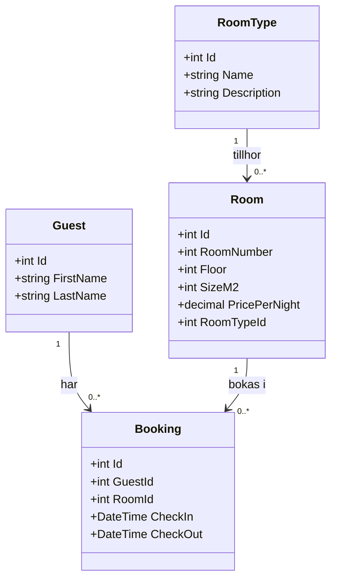

# Hotel Grandioso — Inlämning 1

**Namn:** [David Sundkvist]


## Så kör du projektet

1. Klona projektet från GitHub.
2. Öppna projektmappen i Visual Studio eller VS Code.
3. Öppna en terminal i mappen där `HotelGrandioso.slnx` ligger.
4. Bygg projektet:

```powershell
dotnet build .\HotelGrandioso\HotelGrandioso.csproj -c Release
```

5. Starta programmet:

```powershell
dotnet .\HotelGrandioso\bin\Release\net10.0\HotelGrandioso.dll
```

Programmet använder SQLite och EF Core för att hantera hotellbokningar.


## Databas

Jag använder SQLite tillsammans med Entity Framework Core (EF Core).

Projektet använder Code First, vilket betyder att databasen byggs utifrån mina C#-klasser.

`HotelContext` ärver från `DbContext` och hanterar anslutningen till databasen.

Migrationerna finns i mappen `Migrations` och används för att skapa och uppdatera databasens tabeller.

För att uppdatera databasen kör jag följande kommando från projektets huvudmapp:

```bash
dotnet ef database update --project HotelGrandioso
```

När programmet startar körs `db.Database.Migrate()`, som automatiskt skapar eller uppdaterar databastabellerna med hjälp av migrationerna.

Därefter körs `HotelSeeder.Seed(db)`, som lägger till hotellets 15 rum och tre rumstyper om de inte redan finns.

## UML-klassdiagram




## GDPR

Jag har valt att bara spara de personuppgifter som behövs för att hantera hotellbokningar. Detta följer GDPR:s princip om dataminimering.

- **Id:** Används för att identifiera gästen och koppla gästen till en bokning.
- **Name:** Jag har delat upp namnet i `FirstName` och `LastName` för att kunna identifiera vem som bokar.
- **HairColor:** Sparas inte eftersom hårfärg inte behövs för en hotellbokning.
- **HeightCm:** Sparas inte eftersom gästens längd inte behövs.
- **Religion:** Sparas inte eftersom religion är en känslig personuppgift som inte behövs för bokningssystemet.

Jag har därför bara inkluderat `Id`, `FirstName` och `LastName` i min `Guest`-klass.


## Designmönster
## Designmönster

Jag har delat upp programmet i olika klasser för att varje klass ska ha ett tydligt ansvar. Detta följer principen SRP (Single Responsibility Principle).

- `HotelContext` hanterar anslutningen till SQLite-databasen via EF Core.
- `HotelRepository` ansvarar för att hämta, spara och ta bort information i databasen.
- `BookingService` ansvarar för bokningslogiken och kontrollerar bokningsregler, exempelvis att förhindra dubbelbokningar.
- `BookingMenu` hanterar användarens inmatning och visar information i konsolen.

### Repository Pattern

Jag använder Repository Pattern för att separera databasarbetet från bokningslogiken. `BookingService` använder nu `HotelRepository` istället för att kommunicera direkt med `HotelContext`.

Jag har valt denna uppdelning för att göra koden lättare att förstå, testa och underhålla.

## Tekniker

- C# / .NET 10
- Entity Framework Core
